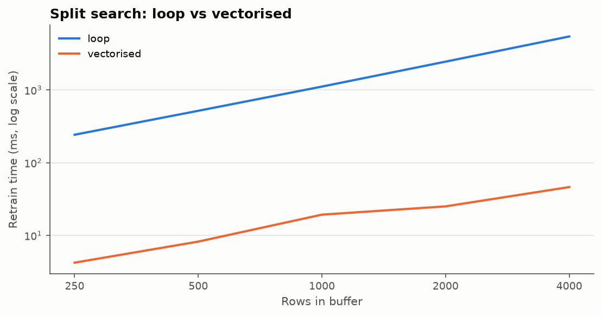
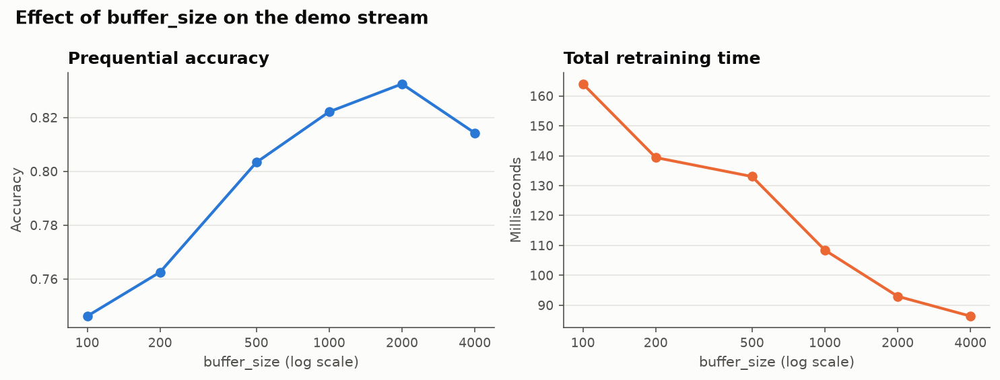
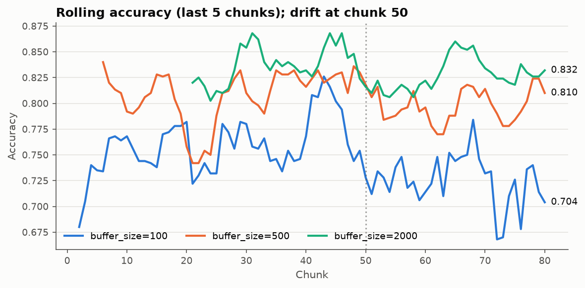

# Benchmark results: NumCompute-Stream (Assignment 2.2)

Generated by `python benchmark/bench_stream.py`.
Times are medians over repeats after a warm-up (the slow loop versions of A1 run once).
Machine: x86_64, Python 3.13.18,
NumPy 2.5.4, matplotlib 3.11.2. Absolute times vary by machine;
the ratios are what matter.

## A. Loop-based vs vectorised implementations

### A1. Tree split search (one retrain on the buffer, `max_depth=6`, 8 features)

The loop version tries every threshold of every feature in Python; the vectorised
version sorts each feature column once and gets the class counts left of every cut
from one `np.cumsum`, then scores all cuts at once. Both build the same tree.

| buffer rows retrained on | loop (ms) | vectorised (ms) | speed-up | same tree |
|---|---|---|---|---|
| 250 | 242.5 | 4.23 | 57x | yes |
| 500 | 517.3 | 8.25 | 63x | yes |
| 1000 | 1112.6 | 19.34 | 58x | yes |
| 2000 | 2449.1 | 25.13 | 97x | yes |
| 4000 | 5431.5 | 46.29 | 117x | yes |

### A2. Prediction on an incoming chunk (tree of depth 8)

Loop: walk the tree sample by sample. Vectorised: move all rows down one level per
step with fancy indexing, so the Python loop runs `depth` times instead of `rows` times.

| chunk rows | loop (ms) | vectorised (ms) | speed-up |
|---|---|---|---|
| 100 | 0.31 | 0.064 | 5x |
| 1000 | 3.00 | 0.183 | 16x |
| 10000 | 29.72 | 1.440 | 21x |

### A3. Running mean / variance over 100-row chunks (8 features)

Loop: Welford's update one sample at a time. Vectorised: per-chunk moments with
NumPy, merged with Chan's formula (`StandardScaler.partial_fit`). Same results.

| rows | chunks | per-sample loop (ms) | per-chunk merge (ms) | speed-up |
|---|---|---|---|---|
| 2000 | 20 | 5.9 | 1.02 | 6x |
| 20000 | 200 | 55.8 | 7.86 | 7x |
| 100000 | 1000 | 291.7 | 40.62 | 7x |

### A4. Confusion matrix of a 5000-row chunk

Assignment 2.1 built it with a k x k loop of comparisons; the streaming version
encodes each (true, predicted) pair as one integer and calls `np.bincount` once.

| classes | k x k loop (ms) | bincount (ms) | speed-up |
|---|---|---|---|
| 3 | 0.20 | 0.205 | 1x |
| 10 | 0.51 | 0.260 | 2x |
| 30 | 2.73 | 0.236 | 12x |

## B. Effect of `buffer_size` (demo stream: 8000 rows in 80 chunks of 100)

Pipeline: Imputer -> StandardScaler (numeric), OneHotEncoder (`day_type`), then
`DecisionTreeClassifier(max_depth=6)`. Prequential (test-then-train) evaluation.
The light sensor is replaced at row 5000 (chunk 50).

| buffer_size | first scored chunk | retrains | prequential acc | macro F1 | acc chunks 41-50 | acc chunks 51-60 (after drift) | ms / retrain | total retrain ms | peak KiB |
|---|---|---|---|---|---|---|---|---|---|
| 100 | 2 | 80 | 0.746 | 0.733 | 0.765 | 0.726 | 2.1 | 164 | 28 |
| 200 | 3 | 40 | 0.763 | 0.747 | 0.772 | 0.750 | 3.5 | 139 | 27 |
| 500 | 6 | 16 | 0.803 | 0.797 | 0.823 | 0.792 | 8.3 | 133 | 46 |
| 1000 | 11 | 8 | 0.822 | 0.815 | 0.828 | 0.800 | 13.6 | 108 | 85 |
| 2000 | 21 | 4 | 0.833 | 0.824 | 0.836 | 0.817 | 23.2 | 93 | 162 |
| 4000 | 41 | 2 | 0.814 | 0.810 | 0.816 | 0.821 | 43.2 | 86 | 305 |

### Reading the results

* **Accuracy rises with buffer_size up to a point, then falls.** Each tree sees more
  rows, so its splits are less noisy. Very small buffers (100 rows is about 17 hours
  of readings) learn from too little data and do not cover a full day/week cycle.
  The largest buffer does worse again: its single tree is used for a long time and
  the stream has to wait longer before any tree exists at all.
* **A small buffer starts predicting sooner** (the first scored chunk is
  `buffer_size / 100 + 1`); with `buffer_size=4000` half the stream goes unscored.
* **Retraining time per retrain grows roughly linearly with buffer_size** (sorting
  dominates), but there are proportionally fewer retrains, so the *total* retraining
  time stays in the same range and even falls slightly.
* **Memory grows with buffer_size**: the peak footprint is the full buffer just
  before a retrain (about 8 bytes x 7 columns x buffer_size, plus Python overhead).
* **Drift**: a model only adapts after its next retrain, so the reaction delay is up
  to `buffer_size` rows. Every setting loses some accuracy in chunks 51-60; the
  drop is mild because CO2 and noise still carry the occupancy signal.
* A4 shows vectorising does not always pay at tiny sizes: with 3 classes the k x k
  loop is only 9 comparisons, so the two versions take about the same time.
